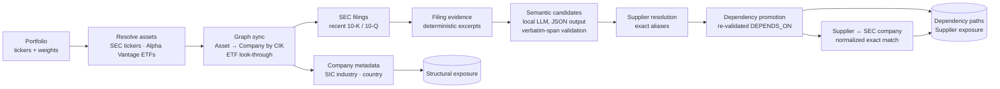

# Pipeline

How a portfolio becomes an explainable exposure graph. Every step is a separate,
bounded API call (or a UI button that runs them in order), so large ETFs never
trigger hundreds of provider requests in one request, and each step can be
re-run safely. See [`graph-schema.md`](graph-schema.md) for node and edge
definitions and [`configuration.md`](configuration.md) for settings.



## Steps

Listed instruments remain `Asset` nodes because the same economic company can be represented by more than one security. When SEC ticker data provides a CIK, the graph creates one canonical `Company` node keyed by that CIK and links the asset with `REPRESENTS`. ETF constituents that cannot be resolved to a canonical company remain valid `Asset` nodes and are reported by graph sync.

Company metadata enrichment is a separate bounded step. It reads the SEC submissions JSON for canonical companies and stores the SEC primary SIC classification as `OPERATES_IN` plus the SEC business-address country as `BASED_IN`. These are structural facts, not numeric exposure weights. The endpoint defaults to 25 companies per call so large ETFs do not trigger hundreds of SEC requests in one synchronous request.

SEC filing ingestion is also bounded and currently stores only recent `10-K` and `10-Q` metadata. Each filing is a canonical `Filing` node keyed by SEC accession number and linked from its canonical company with `FILED`. The node keeps the filing date, report date, form, primary-document URL, filing-index URL, and submissions source URL.

Filing evidence extraction is a separate bounded step. It downloads stored SEC primary-document URLs and records conservative dependency-related excerpts as `Evidence` nodes linked with `CONTAINS_EVIDENCE`. Extraction is deterministic keyword matching (`sec_html_dependency_keywords_v3`), not an AI judgment. An evidence node is only a source excerpt/candidate and does not create or imply a `DEPENDS_ON` relationship.

The next graph layer stores structured `RelationshipCandidate` nodes linked from source evidence with `SUPPORTS_CANDIDATE`. An optional local Ollama provider can populate these candidates from Evidence using constrained JSON output plus deterministic validation of verbatim mentions and supporting text. If no semantic provider is configured, targets remain unresolved and are not marked as processed. Candidate mentions can then be resolved deterministically into internal canonical `Supplier` identities through `RESOLVES_TO`. Explicit filing aliases such as `Samsung Electronics Co., Ltd., or Samsung` are preserved and reused; exact aliases already known in the graph are reused conservatively. A resolved candidate still is not trusted by itself; a separate bounded promotion step re-validates source spans and Supplier aliases before creating a qualitative, provenance-linked `DEPENDS_ON` edge.

The dependency-path API traverses portfolio holdings through canonical companies to promoted Suppliers and returns the source provenance required to explain each dependency. `company_path_weight_pct` is only the sourced direct or one-level ETF look-through weight reaching the dependent Company. It is not a supplier-dependency percentage, and `DEPENDS_ON` adds no numeric multiplier.

Supplier exposure aggregates the same promoted, provenance-backed dependencies as the dependency-path API, without its limit. The unit is a holding route to a company (NVDA held directly, or NVDA inside QQQ): its sourced weight is added once to every Supplier, and once to every supplier role, that the company depends on. A Supplier's weight therefore means "portfolio/look-through weight reaching companies that depend on this Supplier". Because a company usually depends on several suppliers, supplier and role weights overlap and can sum to more than 100%. `dependency_coverage_pct` counts each route once. As with dependency paths, no numeric supplier impact is inferred.

Suppliers linked to an SEC registrant (see `docs/graph-schema.md`) also report `held_weight_pct`: the sourced portfolio/look-through weight already held in the supplier itself. For example, a portfolio of 80% NVDA and 20% TSM depends on TSMC through NVIDIA and also holds TSMC directly at 20%: a concentration a plain holdings list does not show.

Structural exposure aggregation reuses only sourced numeric weights already present on `OWNS` and `HOLDS`. An industry bucket therefore means "portfolio/look-through weight whose canonical company has this SEC primary SIC". A country bucket means "portfolio/look-through weight whose canonical company has this SEC business-address country". It is not a revenue-by-country estimate, and no numeric weight is inferred from `OPERATES_IN` or `BASED_IN` themselves. Coverage fields report how much portfolio/look-through weight currently has metadata for each dimension.

## Unseen tickers: the enrichment queue

A syntactically valid ticker that no provider recognises at portfolio creation becomes `PENDING_ENRICHMENT` and gets an enrichment job. There is at most one active job per ticker, shared by every portfolio holding it. Processing a job retries the asset providers for that ticker:

- resolved: the job is `completed`, the asset registry is updated, and every portfolio holding the ticker as pending gets the resolved asset (the portfolio becomes `ready` once nothing is pending or unsupported). Re-run graph sync to bring the new asset into Neo4j.
- a ticker previously marked `UNSUPPORTED` is not trusted forever: when a new portfolio holds it, it becomes pending again and gets a fresh job, which upgrades every portfolio holding it if a provider now recognises it.
- not resolved: the job goes back to `queued` with `last_error` until `ENRICHMENT_MAX_ATTEMPTS` (default 3), then `failed`. On the final attempt the asset becomes `UNSUPPORTED` only if every provider answered and none recognised the ticker; if a provider errored (network, missing `SEC_USER_AGENT`), the asset stays pending and a new portfolio holding it queues a fresh job.

A claimed job carries a 10-minute lease, so a job left `processing` by a crashed worker becomes claimable again. With PostgreSQL, jobs are claimed with `FOR UPDATE SKIP LOCKED`, so several workers never process the same job.

Process the queue on demand with `POST /api/v1/enrichment-jobs/process?limit=10`, or start a background worker with the app:

```bash
export ENRICHMENT_WORKER_INTERVAL_SECONDS="30"   # 0 (default) disables the worker
export ENRICHMENT_WORKER_BATCH_SIZE="10"
```

A requeued job waits before its next attempt: the delay starts at `ENRICHMENT_RETRY_BASE_SECONDS` (default 60) and doubles per attempt, capped at `ENRICHMENT_RETRY_MAX_SECONDS` (default 3600). With the defaults, the second attempt happens at least 1 minute after the first and the third at least 2 minutes after the second, so a short provider outage does not use up every attempt. The job's `next_attempt_at` shows when it becomes due; processing runs before then skip it.

## Semantic extraction (optional local LLM)

Semantic extraction is optional. To use a local Ollama model:

```bash
export SEMANTIC_PROVIDER="ollama"
export OLLAMA_BASE_URL="http://localhost:11434"
export OLLAMA_MODEL="qwen3:4b-instruct"
```

With `SEMANTIC_PROVIDER` unset, the rest of the application still works and semantic-candidate Evidence remains available for later processing. Ollama is contacted only when the semantic-candidate sync endpoint is called.
